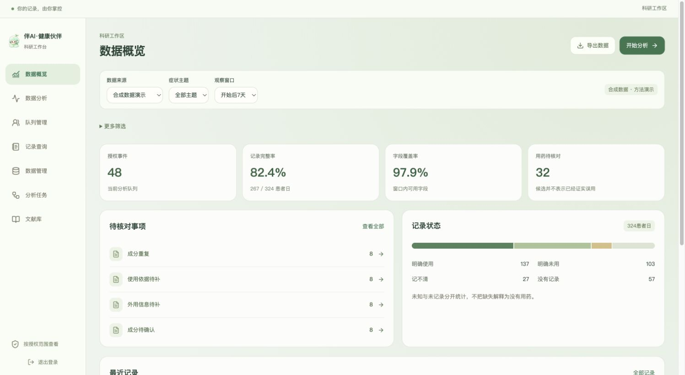
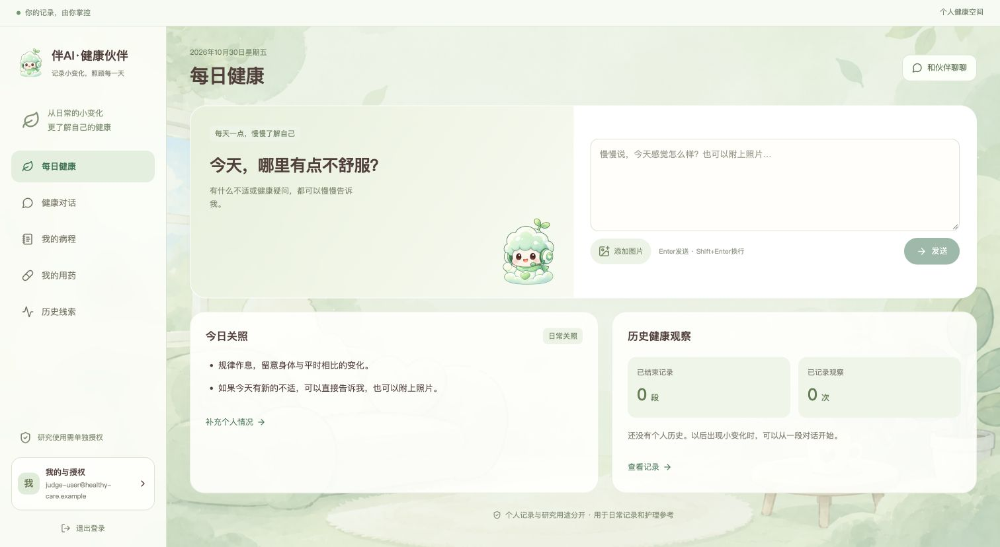
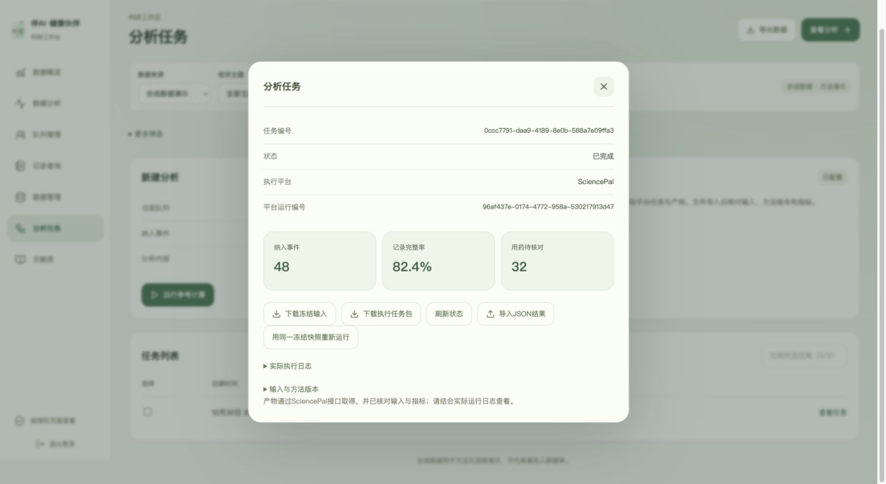
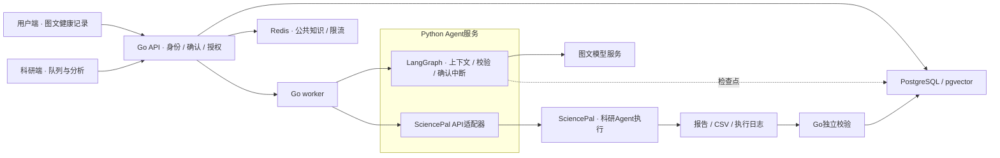

<div align="center">
  
  <h1>伴AI · 健康伙伴</h1>
  <p><strong>日常有人关照，研究有据可循。</strong></p>
  <p>图文对话记录院外健康过程，让症状、实际用药与恢复成为可追溯、可复核的研究数据。</p>
  <p>
    
    
    
    
    
  </p>
  <p>
    <a href="https://admissions-broadband-bend-vanilla.trycloudflare.com/">用户端演示</a> ·
    <a href="https://admissions-broadband-bend-vanilla.trycloudflare.com/research/">科研工作台</a> ·
    <a href="#项目演示">观看4:59演示</a> ·
    <a href="https://sciencepal.ai/share/65ecd584-6adf-4000-88d9-4004e3f82a65">SciencePal运行回放</a>
  </p>
</div>

<p align="center">
  <a href="#项目演示">项目演示</a> · <a href="#核心能力">核心能力</a> · <a href="#快速开始">快速开始</a> · <a href="#sciencepal科研闭环">SciencePal科研闭环</a> · <a href="#验证与复现">验证与复现</a> · <a href="#文档">文档</a> · <a href="#路线图">路线图</a>
</p>

## 项目演示

**4分59秒 · 从个人健康记录，到可追溯的院外健康研究。**

https://github.com/user-attachments/assets/d07c2808-4b52-4b38-ae56-620eefdfac52

| 时间 | 展示内容 |
| --- | --- |
| 00:00 | 科学问题：零散自述如何成为连续研究数据 |
| 00:24 | 用户端：新冠相关不适、对话记录、用药与恢复 |
| 01:18 | 研究授权、持续连接与安全设计；在线医生为拟接入功能 |
| 02:08 | 研究思路与科研工作台：观察窗口、用药候选、来源追溯 |
| 03:48 | SciencePal实际执行、产物校验与记录复核 |

[观看原版视频](https://admissions-broadband-bend-vanilla.trycloudflare.com/materials/healthy-care-demo-v7.mp4) · GitHub展示版保留完整画面、字幕与配音。

> [!NOTE]
> 当前提供日常健康记录、护理参考与用药信息核对。具体药品用量尚未发布；在线医生与处方确认属于后续计划。实验和演示案例均为合成数据，尚无临床有效性结论。

## 为什么做这个项目

许多轻症没有进入医院，却经历了症状变化、自主用药和恢复。这些过程往往停留在记忆和零散对话中，难以用于连续观察和院外用药研究。

伴AI·健康伙伴将个人健康空间与科研工作区连接起来，围绕两个可验证的问题设计：

- **采集问题**：追问和持续记录能否补充有来源支持的信息，并保留未知与缺失？
- **分析问题**：连续记录能否支持固定观察窗口分析，定位需要进一步核实的用药信息？

产品的起点是一段亲切的对话；研究的起点是一份经过授权、保留来源和版本的记录。

## 核心能力

| 面向用户 | 面向科研 |
| --- | --- |
| **自然图文对话**：描述不适、补充照片，模型整理动作草案 | **队列与窗口**：按主题、观察窗口、日期和可用性筛选 |
| **确认与更正**：确认后保存，不猜测未提供的健康事实 | **记录质量**：字段覆盖、患者日分母、未知与缺失分别统计 |
| **持续跟进**：每日观察、实际用药、站内提醒和结束跟进 | **用药核对**：定位信息缺口与重复成分候选，回查记录来源 |
| **每日关照**：有当前不适、已结束有历史、首次使用三种状态 | **冻结与复核**：固定输入、版本和哈希，导出与比较分析任务 |
| **数据与授权**：个人导出、删除，研究与影像用途独立决定 | **SciencePal执行**：实际运行脚本，取回报告、CSV与日志后独立校验 |

<details>
<summary><strong>查看双端界面与SciencePal任务结果</strong></summary>

### 科研工作台



### 个人健康空间



没有正在跟进的不适时，首页邀请用户描述新的变化；已有记录用于历史观察和日常关照。

### 科研任务详情



截图来自真实产品操作。案例与研究数据为虚构或合成数据，不代表真实患者结局。

</details>

## 快速开始

需要 **Docker Compose 2.24.4+** 和 **Python 3.10+**。Go、Node.js、数据库和Agent运行环境由容器提供。

### 1. 取得源码并生成本机配置

```sh
git clone https://github.com/bamboo-ye/healthy-care.git
cd healthy-care
python3 scripts/bootstrap.py
```

脚本创建私有 `.env` 并生成所需密码；已有配置不会被覆盖。[`.env.example`](.env.example) 仅包含模板。

### 2. 配置需要的外部服务

在本机 `.env` 中填写：

```dotenv
AGENT_PROVIDER=openai_compatible
MODEL_BASE_URL=https://your-provider.example/v1
MODEL_NAME=your-vision-model
MODEL_API_KEY=replace-with-your-model-key
MODEL_TEMPERATURE=

SCIENCEPAL_BASE_URL=https://sciencepal.ai/api
SCIENCEPAL_AGENT_ID=replace-with-your-agent-id
SCIENCEPAL_API_KEY=replace-with-your-sciencepal-key
```

对话模型需支持图片输入、流式响应和JSON输出。SciencePal需配置具备Python执行与文件读写能力的科研Agent；两种服务使用各自的凭据。配置方法及兼容参数见 [启动与配置指南](docs/getting-started.md)。

### 3. 启动服务

```sh
docker compose up -d --build
docker compose ps
curl --fail http://localhost:8780/readyz
```

| 入口 | 地址 | 登录方式 |
| --- | --- | --- |
| 用户端 | <http://localhost:8780/> | 在页面创建个人账户 |
| 科研端 | <http://localhost:8780/research/> | 使用本机 `.env` 中初始化的科研账户 |

默认只绑定宿主回环端口。使用配置中的 `localhost` 入口；如更换域名或端口，同步调整 `APP_ORIGIN`。

在线演示使用独立评审账号，科研凭据通过非公开渠道交付。演示域名是临时隧道地址，隧道重建后可能变化。

## SciencePal科研闭环

SciencePal承担核心科研执行，科研人员在工作台中完成操作。用户端的日常对话由另行配置的图文模型提供。

1. **选择队列**：设定合成数据、症状主题与3天或7天观察窗口。
2. **冻结输入**：保存队列定义、数据与方法版本，生成输入哈希和manifest。
3. **平台执行**：调用在SciencePal创建的科研Agent，实际运行随任务提供的Python脚本。
4. **取得产物**：经平台API取回 `report.json`、CSV、stdout和stderr。
5. **独立复核**：校验输入、版本和统计指标，再在科研端展示可追溯结果。

当前外部执行只开放合成输入。任务状态不明确时保留待核实状态，避免重复启动；文件导入与认证API取得的产物分别标记来源。

[Agent系统提示词](docs/sciencepal-agent-system-prompt.md) · [接口、状态与复现](docs/sciencepal-integration.md) · [公开运行记录](https://sciencepal.ai/share/65ecd584-6adf-4000-88d9-4004e3f82a65)

## 技术架构



| 层次 | 实现 |
| --- | --- |
| 界面 | React 19、TypeScript、Vite、Lucide，用户与科研双入口 |
| 业务 | Go、Gin、pgx/sqlc、worker、持久事件与动作确认 |
| Agent | Python 3.12、FastAPI、LangGraph、PostgreSQL检查点 |
| 数据 | PostgreSQL 17、pgvector、Redis 7.4，私有附件卷 |
| 部署 | Docker Compose、Caddy、独立备份服务；可选HTTPS覆盖 |

模型只提出动作；Go在确认事务中重新验证归属、版本与权限。Redis不保存聊天、图片或授权决定。pgvector已安装，当前小型知识包使用确定性查询。

## 验证与复现

### 已有技术证据

| 检查 | 已保留的结果 | 说明 |
| --- | --- | --- |
| Agent运行时 | 32项通过 | 2026-10-23，含确认中断、恢复、协议与校验 |
| 真实图文服务基础链路 | 6项通过 | 合成文字及人工色块传输，非医学图片准确率 |
| 真实模型业务流程 | 19项通过 | 2026-10-23，含未知、确认、更正、归档及授权撤回 |
| 评审角色隔离与平台联调 | 通过 | 2026-10-30，专用账号下完成SciencePal任务并校验产物 |

完整记录见 [真实服务验收](docs/live-service-acceptance-2026-10-23.md)、[平台执行证据](docs/sciencepal-live-acceptance-2026-10-23.md) 和 [当前状态](docs/project-status.md)。

### 两项独立的合成研究任务

- **患者日分析**：固定48例队列中267/324患者日有记录，完整率82.4%，产生32项用药待核对候选。
- **追问组件对照**：开发12例、测试48例，测试集来自16模板簇。SciencePal评分已采集的模型观测。

| 组件实验条件 | 来源支持字段宏平均召回率 |
| --- | ---: |
| 初始描述 | 30.10% |
| 通用结构化追问 | 77.95% |
| 定向结构化追问 | 79.97% |

定向相对通用为 **+2.01个百分点**，模板簇Bootstrap 95%区间 **[-4.31, +10.69]**，包含零；尚未建立定向策略优势。两项任务的样本与指标各自独立，不能合并为产品或临床准确率。

### 离线重算

以下操作只使用公开合成观测和Python标准库，不调用外部模型：

```sh
python3 -m unittest discover -s analysis/recording_benchmark -p 'test_*.py'
python3 analysis/recording_benchmark/run_analysis.py \
  output/recording-benchmark-20261024/health-research-input.json \
  --out .local/benchmark-recomputed
```

[协议与方法](analysis/recording_benchmark/README.md) · [结果与局限](docs/submission/benchmark-results-2026-10-24.md) · [冻结输入与参考结果](output/recording-benchmark-20261024/) · [平台原始产物](output/recording-benchmark-platform-evidence-20261024/)

### 完整软件验收

```sh
python3 scripts/acceptance.py
```

该命令创建独立 `healthy-care-test` 环境，执行构建、API、重试、备份和恢复等检查；不修改主部署，也不使用模型额度。[真实服务验收命令与开发检查](docs/getting-started.md#软件验收) 另行执行，结果不能替代真人可用性或临床研究。

## 文档

| 我想了解 | 入口 |
| --- | --- |
| 如何启动和配置 | [本地启动、模型与SciencePal配置](docs/getting-started.md) |
| 系统的数据与接口约定 | [身份、确认、时间、未知与研究边界](docs/implementation-contracts.md) |
| 如何部署与恢复 | [HTTPS、备份、恢复和删除](docs/operations.md) |
| 科研问题及验证方法 | [研究设计](docs/research-design.md) · [组件实验协议](analysis/recording_benchmark/protocol.md) |
| 当前完成了什么 | [当前项目状态](docs/project-status.md) |
| 查看比赛材料 | [五页项目说明](output/pdf/health-companion-project-description.pdf) · [提交索引](docs/submission/submission-index.md) |
| 查看配置、导出与复现包 | [补充材料及访问方式](docs/submission/supplementary-links.md) |
| 用户测试如何进行 | [独立可用性执行计划](docs/submission/usability-session-kit.md)，尚未开展 |

<details>
<summary><strong>仓库目录</strong></summary>

```text
apps/web/                     用户端、科研端及共享样式
backend/                      Go API、worker、迁移与独立校验
agent/                        LangGraph运行时及SciencePal适配
analysis/                     合成输入、独立分析与组件基准
prototype/                    前期原型与研究方法追溯
output/recording-benchmark-*/  已公开的冻结观测和平台产物
output/supplementary/         脱密配置、工作流结构和科研复现包
deploy/                       镜像、网关、数据库与备份配置
tests/                        API、恢复和真实服务验收
scripts/                      配置、验收、备份及材料制作工具
docs/                         使用、实现、研究和阶段记录
```

锁文件和镜像摘要随代码保留；本机配置、备份、原始录屏与生成音频不进入仓库。

</details>

## 路线图

- [x] 图文对话、确认与更正、连续记录、独立授权和双端界面
- [x] SciencePal实际执行、产物取回、独立校验及可复现实验
- [x] Docker部署、恢复验收与公开评审材料
- [ ] 改善未知编码，新增独立自然语言留出集与标注
- [ ] 开展独立真人可用性反馈和专业内容审阅
- [ ] 接入在线医生评估与处方确认，验证完整服务流程
- [ ] 在明确授权与预设终点下开展真实院外观察研究

## 资源与许可

运行依赖、公开知识来源和使用依据见 [资源使用声明](docs/resources.md)。自研代码当前未设置统一开源许可证；第三方代码与素材仍遵循各自许可。公开仓库不表示第三方模型、平台或参考素材属于本项目原创。

README的信息组织参考 [Immich](https://github.com/immich-app/immich) 的产品展示与入口设计，以及 [LangGraph](https://github.com/langchain-ai/langgraph) 的能力说明与文档导航。项目实现和验证内容依据本仓库的实际工程与证据整理。
