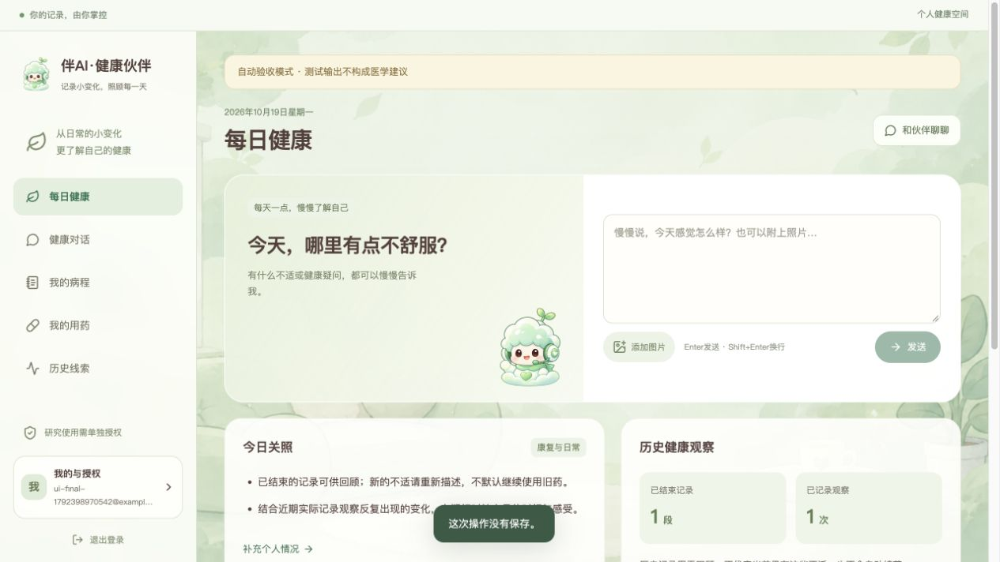
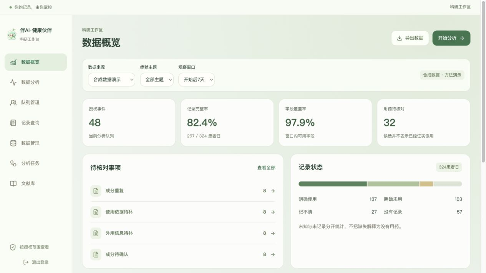
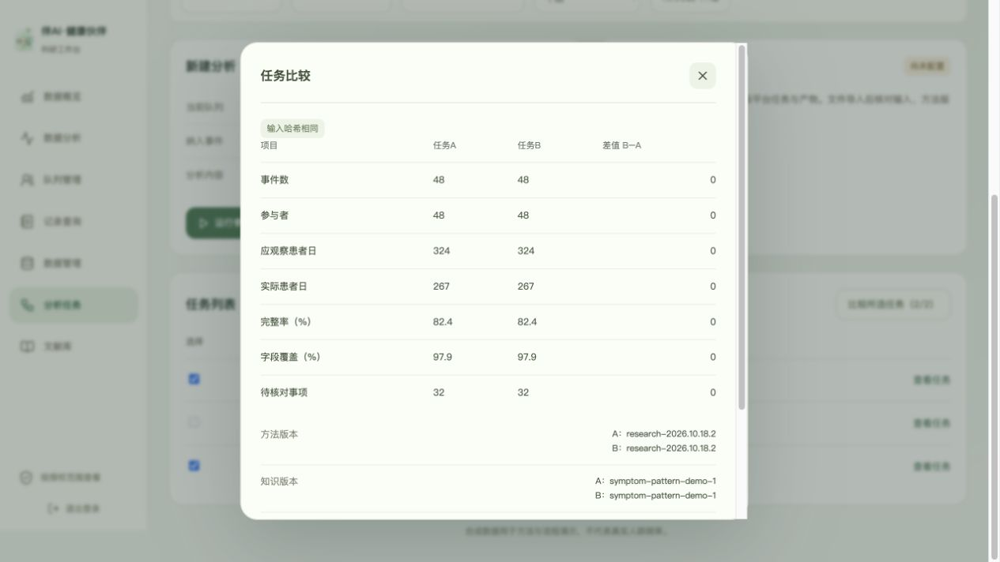
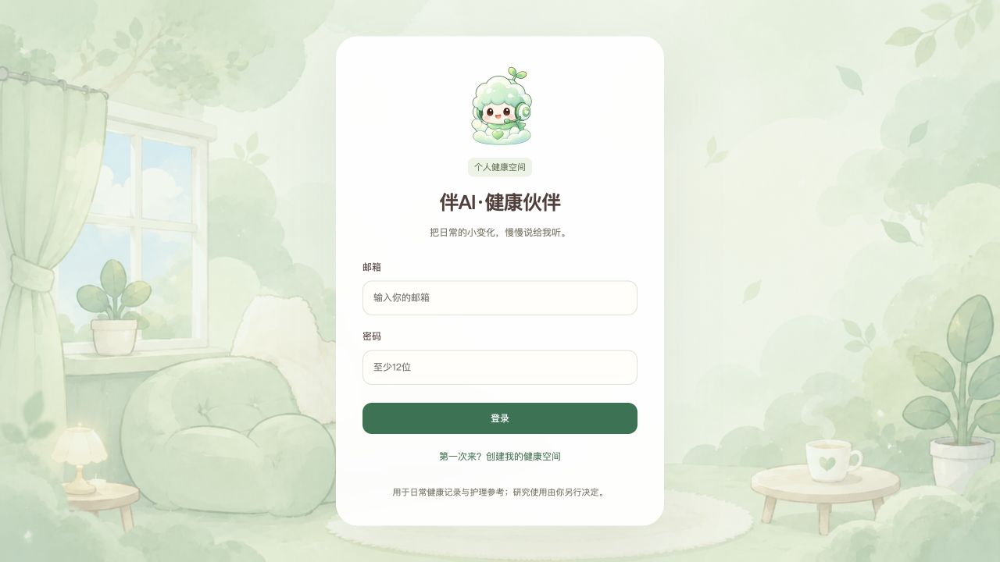

# 开发与自动验收记录

本地软件验收日期：2026年10月19日；2026年10月23日增补SciencePal真实平台验收。本地Docker部署，所有验收资料为合成数据。

**结论：下列已实现功能的本地技术验收通过。2026年10月23日SciencePal实际运行及认证API产物校验通过，见[专项证据](sciencepal-live-acceptance-2026-10-23.md)。真实图文模型6项、业务19项及最新完整软件回归通过，见[真实服务验收](live-service-acceptance-2026-10-23.md)。用户已确认当前保留护理参考与用药记录，暂不发布具体产品用量。**

## 自动验收

| 检查 | 实际结果 | 覆盖 |
| --- | --- | --- |
| Go | 18个测试函数与表驱动分支通过，race与vet通过 | Python一致的输入哈希与指标、窗口、未知、类型、图片、历史否定、公式注入、参与者/患者日去重、运行签名、产品发布门槛与历史组合 |
| Python | 18 passed | LangGraph中断与重编译恢复、明确配置、图文HTTP契约、来源/剂量/确诊拦截、紧急提示优先、SciencePal文件/状态/控制与产物大小限制、节点耗时与失败、Token结束帧及缺失成本 |
| 前端 | 2 passed，TypeScript与Vite生产构建通过 | 空缺数值、来源链接约束及完整编译 |
| API端到端 | 9项通过 | 真实PostgreSQL/Redis/Go/LangGraph；确认前不写入、回执幂等、同日修订、版本冲突、用药更正、图片隔离、提醒、归档、研究筛选与导入拒绝、撤回、并发与SSE补拉、删除、运行耗时/Token元数据持久化 |
| 恢复与清理 | 7项通过 | worker排队恢复、检查点中断恢复、Redis丢失、PostgreSQL重启后继续对话、实际带签名取图、全新库/附件恢复、检查点清理及进行中删除不反弹；相关情形合并在7个输出检查中 |
| 每日备份 | 2项通过 | 容器实际生成快照并恢复事件与图片、失败不标成功、删除等待备份锁并在释放后完成 |
| 产品说明接入 | 集成验收通过 | 合成说明导入幂等、版本不可覆盖、产品身份与背景门槛、单位不一致、撤回后不发布；不代表真实专业审阅 |
| 消息重试 | 集成验收通过 | 保留原消息和图片、新运行、重试回执幂等、归属、同client_id并发不重复 |
| 高级队列 | 集成验收通过 | 日期/产品/可用性、保存定义、纳入排除数、冻结输入、CSV与独立Python结果一致 |
| 浏览器 | 32项通过，0条error日志 | 三类首页、确认保存、随访、纯图片与放大、归档、默认授权、角色隔离、筛选、队列、真实参考任务、版本说明、重试、任务比较/重跑、高级筛选错误状态、文献与390×844布局 |
| 部署配置 | 通过 | 镜像构建、迁移、容器健康、可选HTTPS Compose与Caddy语法校验 |
| 生产前端依赖 | npm audit报告0条漏洞 | 仅生产前端依赖，不代表整个系统完成安全审计 |

一键复现：

```sh
python3 scripts/acceptance.py
python3 tests/performance_smoke.py
```

测试只重置 `healthy-care-test`。临时恢复项目以 `healthy-care-restore-*` 命名；恢复后逐项比较数据库数量、检查点和图片字节，再删除本次临时恢复卷。主部署数据不重置。完整本机日志在 `.local/acceptance-latest.log`、浏览器记录在 `.local/browser-acceptance.json`，不含外部密钥。

## 关键实际计算

| 冻结合成队列 | 应观察患者日 | 实际记录日 | 完整率 |
| --- | ---: | ---: | ---: |
| 全部主题、7天 | 324 | 267 | 82.4% |
| 全部主题、3天 | 144 | 129 | 89.6% |
| 皮肤主题、7天 | 54 | 43 | 79.6% |
| 皮肤主题、3天 | 24 | 21 | 87.5% |

固定原始输入SHA256为 `c4fae3592e5dd5703019372cfa775651a1529d49e565216e8facf34cf4fb30eb`。默认48份授权合成记录，4类待核对规则各8例，32例候选。测试从下载任务包重新运行独立Python脚本，与Go参考结果对照；篡改指标被拒绝。候选数不是人群滥用率，评分变化不是疾病结局。

## 本机计时

少量串行请求，仅用于建立开发基线。模型生成和SciencePal不包含在内，也不是压力测试、生产SLA或医学性能数字。每类普通查询20次；小PNG仅5次，不能代表真实照片负载。最新原始测量在 `.local/performance.json`。

| 请求 | 样本数 | P50毫秒 | P95毫秒 |
| --- | ---: | ---: | ---: |
| 就绪查询 | 20 | 1.79 | 2.39 |
| 个人状态 | 20 | 2.4 | 2.79 |
| 科研概览 | 20 | 17.18 | 18.8 |
| 小PNG上传 | 5 | 4.45 | 5.33 |


## 发现并修复的故障

- Docker Desktop上直接执行宿主挂载初始化脚本失败：改为数据库镜像内置并由入口脚本读取，已在全新恢复环境验证角色初始化。
- LangGraph辅助查询和检查点共用连接导致并发失败：改用连接池，运行映射使用独立借用连接。
- PostgreSQL重启后Python取到失效连接：取用时检查连接，验证恢复后可继续执行对话。
- 图片能在网页查看但运行时无法取图：修复SQL里UUID与JSONB字符串操作的参数推断，加入实际内部HTTP取图及签名拒绝检查。
- 删除时运行可能继续生成检查点：加入运行取消、删除标记及注册检查，验证等待模型结果期间删除后不会重现检查点。
- 清理旧图片可能误删新上传：删除任务冻结应删ID，只清理请求前的对象。
- 相同消息并发重发可能竞争创建：加入事务级幂等锁；失败运行重试保留原消息和附件，以新运行记录执行。
- 无效科研日期仍显示旧筛选结果：错误状态持续展示、清空并隐藏旧结果，禁止导出；清除条件后恢复实际数据。
- 多条研究查询可能跨越数据变化：在只读REPEATABLE READ事务内冻结真实队列，记录实际截点。

## 页面截图

用户端与科研端均为真实应用界面。带“自动验收模式”的用户截图使用明确启用的测试Provider，只证明交互，不证明医学能力。







手机端：[用户端](screenshots/user-mobile.png)、[科研端](screenshots/research-mobile.png)。

## 未验收项目

真实图文模型已完成合成文本与区域色块图片验收；真实医学影像理解、个体用药判断、疾病识别或临床效果没有验证。SciencePal科研链路已完成一次合成数据实际外部调用。当前6条护理/历史参考没有被标成专业审阅后的产品说明，真实产品剂量知识尚未发布；隔离测试中的合成字段不进入主部署。源码、测试通过率、合成数据计算和平台标签不能替代这些证据。

真实服务技术验收脚本为 `scripts/live_acceptance.py`，配置后可按文字、合成图片、真实平台产物链路检查。尚需专业内容与逐例临床相关评估，详见[实施状态](implementation-status.md)。

## 最终部署核验

2026年10月19日18:13（Asia/Shanghai）更新主部署。就绪接口200，7个常驻服务运行，带健康检查的5个服务均healthy，9份迁移已应用。发布前备份已保存，隔离验收服务已停止，主部署继续运行。主库产品说明0条，测试Provider关闭，Agent运行时连通；模型和SciencePal均未配置。实际状态保存在私有`.local/deployment-status.json`，没有将合成药品说明导入主环境。

最终完整回归日志以`Automated software acceptance passed`结束。真实服务检查因缺少配置在发送请求前退出；没有记录为通过。主部署入口截图：




## 运行计量与材料增补

补齐节点耗时、等待确认/失败状态、运行尝试汇总及供应商返回的Token用量；结束帧choices为空时不会误报格式失败。未返回的用量和没有价格依据的成本保持null。新增3项Python测试后18项通过；完整隔离软件回归再次通过，API验证5个节点计量和回复元数据一致。没有真实服务账单或费用测量。

五页项目说明PDF已逐页渲染检查；演示脚本与资源声明位于docs/submission/。这些是10月19日的材料工作稿；10月23日已另取得真实平台任务链接，材料终稿与最终演示视频仍需准备。

10月19日最新运行计量版本已部署并核验实际镜像与容器健康；主入口维持本机8780，测试服务已停止。10月23日重载SciencePal配置并完成一次平台实际联调，7个常驻容器运行；随后真实图文模型配置并完成6项基础及19项业务验收，最新运行时32项测试和完整隔离回归通过。主部署7个服务运行，5个健康检查正常。专业产品用量保持未发布，符合用户当前确认范围。
