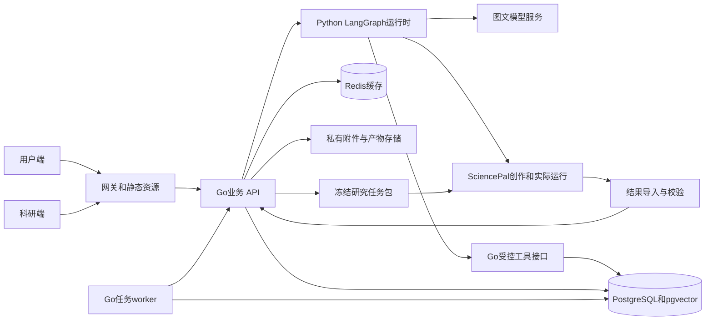

# 伴AI·健康伙伴需求设计与开发计划

更新日期：2026年10月23日。用户本日确认：暂无具体药品说明的专业审阅材料，本轮保持护理参考、实际用药记录与信息核对；产品级用量说明在取得专业审阅后另行发布，不作为本轮开发完成的前置条件。

伴AI·健康伙伴面向符合自主处理条件的日常小病，以亲切的图文对话完成症状梳理、护理与非处方药信息查询、实际用药记录、连续随访和历史线索匹配。独立科研端在研究授权范围内分析院外健康记录，重点关注信息采集质量、用药信息缺口、缺失记录和连续观察。

技术方案采用 **Go 业务后端、Python LangGraph 运行时、PostgreSQL 与 pgvector、Redis 缓存和 Docker Compose 部署**。SciencePal作为核心科研工作流的创作、调试和实际执行平台，保留可访问的运行与复现证据。

用户已于2026年10月19日明确授权按本计划开发并自动验收，工程实施已启动。当前实现与验收状态见[实施状态](implementation-status.md)；原型、合成计算和测试替身不代表真实医疗能力或SciencePal实际执行完成。

本文作为本轮需求和技术方案的统一基线；与早期文档冲突时，以本文为准。早期研究材料保留为方法参考，不进入产品主页面。

## 一 产品范围与交付层级

项目独立实现，名称保留“伴AI·健康伙伴”。用户端与伴AI保持视觉风格和布局一致，采用绿色背景、角色logo、侧栏与工作区；仅展示健康模块。当前不合并伴AI代码，不展示其其他业务内容。

用户端和科研端分别构建、分别进入，由服务端控制权限。医生确认是未来可选功能，不是用户使用、记录入库或科研分析的前置条件。

| 层级 | 本轮定义 |
| --- | --- |
| P0 比赛闭环 | 图文对话、通用轻症事件、适用性边界、可追溯护理参考、实际用药记录与信息核对、每日随访、站内提醒、归档与每日健康、一个历史线索参考主题、独立研究授权、研究查询与分析、SciencePal Agent API接入与真实运行、Docker复现部署 |
| P1 闭环后的增强 | 经专业审阅的具体产品说明与用量信息、更多知识和产品、实时天气、独立药盒OCR与条码、浏览器外推送、设备数据、更复杂科研分析、周期科研任务自动化 |
| P2 仅保留概念 | 在线医生、医生确认、购药下单、支付配送、医疗机构协作 |

轻症入口对所有日常小病开放，不要求选择病种，也不局限于湿疹。首版通过感冒鼻咽、皮肤不适、轻度过敏、胃肠不适、轻微疼痛等代表场景验证通用流程；能提供的具体信息受已审阅知识和产品范围约束。未覆盖的问题仍能记录、追问和给出求助方向，不生成未经支持的个体用药结论。

首版以成年人日常轻症记录和护理参考为范围。儿童、孕哺期、复杂基础疾病或明显超出自主处理条件的情况保留记录和求助提示，不要求等待平台医生审核。本轮不发布具体产品用量信息；专业审阅条件继续由产品说明发布流程执行，不填写虚构审阅记录。

## 二 用户端功能与验收

所有业务操作都提供自然语言入口。涉及授权、删除、归档或更改提醒等动作，以对话中的明确对象与确认完成；可同时提供消息内按钮，不让用户填写长表单。

| 功能 | 要实现的行为 | P0验收条件 |
| --- | --- | --- |
| 健康背景 | 对话补充年龄段、地区、过敏、相关病史、在用药和偏好 | 允许未知和跳过；关键背景不足时继续询问，不猜测 |
| 图文对话 | 多轮追问、流式回答、发送与重试、保留原话 | 用户直接描述不适；不会出现强制症状或病种选择器 |
| 图片输入 | 文字与图片同发、单图输入、预览移除、放大查看 | 每条最多4张、每张8MB；JPEG、PNG、WebP；发送失败保留草稿；质量不足可继续文字交流 |
| 图片理解 | 结合文字描述图片、提取药盒可见信息 | 不把图片或识别文字直接写成确诊、药品成分事实；待确认信息与原始图片关联 |
| 不适事件 | 从对话整理开始时间、部位、程度、影响与变化 | 以episode保存一次不适过程；新旧事件关联有歧义时追问；普通寒暄不创建病程 |
| 适用性判断 | 检查危险信号、知识覆盖和自主处理条件 | 明确给出护理参考、信息不足或进一步求助等行动方向与依据 |
| 分析与护理 | 提炼已知情况、可能方向、自我护理和观察重点 | 区分自述事实、AI提取和知识解释；显示可展开的来源，不虚构诊断概率 |
| 非处方药信息 | 本轮记录实际使用与信息缺口，保留产品说明接入能力 | 不发布未经专业审阅的产品用量；产品不明时补问，不自动处方或续方；已审阅说明的发布为后续增量 |
| 实际用药记录 | 记录产品、成分、规格、途径、用量、频次、时间与使用依据 | 支持已用、明确未用和记不清；没有记录单独计算，不视为未用 |
| 用药核对 | 核对重复成分、单位、产品说明、已有计划及复核节点 | 显示触发记录、参考条目与缺失信息；候选不等于已证实滥用；不套统一停药天数 |
| 每日随访 | 对话记录变化、场景评分、活动影响、实际用药和可选照片 | 同日补充更新版本；保留发生时间与补记时间；不因重试增加患者日 |
| 病程回顾 | 时间线、实际评分点、用药区间、照片与摘要 | 缺失保留空缺；不对症状插值；个人摘要可受控导出 |
| 提醒与待办 | 设置、延后、暂停、完成随访或复核提醒 | P0支持后端持久化调度和站内待办；页面关闭后到期仍能在下次登录看到；站外通知为P1 |
| 历史线索 | 将个人历史症状及变化与有限知识条目匹配 | 展示日期、事实、否定与不确定状态、知识来源和需补充信息；不声称诊断疾病或确定处于早期 |
| 每日健康 | 用少量内容提供分析、建议与下一步观察 | 与详细聊天不重复；新记录能触发摘要更新；高优先级行动优先显示 |
| 今日关照 | 将康复、个人背景、季节及环境因素整合到一个模块 | 不拆成重复的日常关照和个人关照；天气未接入时只给条件性环境建议 |
| 结束跟进 | 用户表示结束或恢复后归档，保留结束原因 | 不把归档当作临床治愈；不自动续用旧药；历史回顾不重新激活病程 |
| 个人数据与授权 | 查看授权、撤回、导出、更正与删除请求 | 研究默认关闭；不参加研究仍可使用健康服务；影像研究单独授权 |

### 没有正在跟进的不适时

首页保留“今天有什么不舒服，或有什么健康问题想了解？”的图文输入。已有历史时，显示已结束记录的康复建议、真实历史数据观察及统一的今日关照；没有历史时显示通用日常关照和可选的背景补充入口。

不预置症状、评分、病程或用药，不用旧病程填充当前疾病。天气接入后必须附城市、来源与更新时间；用户不提供城市也能正常使用。

### 历史线索的能力边界

“防大病”具体实现为历史事实检索、时间关系核对、知识条目匹配和可解释的进一步核实提示。首版选择一个有公开来源的参考主题演示，保留reference标记，不冒充专业内容审阅或临床筛查。不做全疾病预测，不展示未经验证的患病概率，不把没有命中解释为排除疾病。否定表述、已过期事实、互相矛盾的记录和分析截点后的信息必须分别处理。

## 三 科研端功能与研究目标

科研端面向实际数据操作。产品页面不出现“本项目最适合的科学切口”、评分对齐、项目创新性论证、开发计划或提交准备等汇报字段。研究方法、实验协议与参赛材料保留在项目文档和提交包中。

| 页面 | 主要功能 | 验收条件 |
| --- | --- | --- |
| 数据概览 | 授权事件、记录完整率、字段覆盖、用药待核对和最近记录 | 分母、队列、观察窗口一致；标识合成或真实数据；事项可进入明细 |
| 数据分析 | 字段覆盖、用药核对、记录缺失、评分变化和历史线索 | 筛选同步影响图表、明细与导出；方法和来源按需展开 |
| 队列管理 | 按主题、时间、3或7天窗口、产品及数据可用性筛选和保存 | 区分参与者数、事件数和患者日；保存队列定义及排除原因 |
| 记录查询 | 检索去标识记录，查看结构化事实、版本、来源与分析依据 | 本届逐条原文与图片溯源只用合成样例；真实研究默认结构化数据，不默认开放自由文本 |
| 数据管理 | 数据字典、授权范围、质量问题、版本、受控导出 | 研究角色无法读取身份映射；导出和下载重新检查当前权限与授权 |
| 分析任务 | 创建任务、冻结快照、获取任务包、导入结果、比较版本与重跑 | 显示真实状态、运行平台、输入哈希、方法版本、日志与产物；外部未执行时不显示成功 |
| 文献库 | 按主题查询已收录文献、摘要、原文与关联知识条目 | P0采用审阅后的静态文献包；不做无来源的自动医学知识发布 |

首版不设置医生审核队列，不让用户等待医生确认，也不将科研结论自动推回个人用药建议。

### 可验证的科学问题

核心问题是：**有来源约束和定向追问的连续对话，能否形成更完整、可核实的院外轻症与自主用药记录？** 研究输出关注数据可用性和方法表现，不能由合成数据推出临床获益。

| 问题 | 分析和实验 | 主要指标或约束 |
| --- | --- | --- |
| 信息采集质量 | 对照首次描述、等预算自由对话、结构化追问 | 同字段提取准确性、完整性、原文依据覆盖、追问次数；模型、知识和信息预算可比 |
| 用药信息核对 | 在有已知标签的样例上检查重复成分、信息缺口和说明核对 | 候选的精确率与召回率、误报类别；不命名为人群滥用率 |
| 连续记录缺失 | 分开统计使用、未用、未知和无记录 | 患者日完整率、失访、3与7天窗口差异；极端情境不冒充置信区间 |
| 症状变化 | 在同主题、同量纲内对比首末可用评分 | 配对事件数、实际起始观察日、缺失程度；不由归档判断治愈 |
| 历史匹配可靠性 | 测试否定、时间窗、矛盾、重复、缺失与未来信息 | 来源正确性、提示负担、规则行为和时间泄漏；没有结局标签时不报疾病准确率 |

参考既有[研究设计](research-design.md)、[第一轮研究材料](competition-research.md)和[第二轮研究材料](research-expansion-2.md)制定版本化实验协议。规则行为测试与真实模型测试分开记录；更多轮次带来的信息增加，不直接解释为交互策略的因果收益。

## 四 前端与交互设计

### 两个独立应用入口

用户端包含每日健康、健康对话、我的病程、我的用药、历史线索及个人授权入口。科研端采用前节七个页面。两端可共享设计token、图标和基础组件，但没有面向普通用户的科研角色切换，也不依赖前端隐藏菜单实现权限控制。

建议工程化采用React、TypeScript和Vite，拆分`web-user`、`web-research`与共享`ui`包。此前伴AI仓库的具体依赖未纳入本次已确认信息，React是本项目的建议选型；如后续核对出不同框架，再评估复用方式，不影响当前Go和Agent接口设计。

| 设计对象 | 约定 |
| --- | --- |
| 用户端视觉 | 沿用已确认的绿色背景、角色logo、柔和卡片、左侧导航与主工作区 |
| 用户首页 | 问候和图文输入为入口；按当前不适、已归档有历史、首次使用三个状态组织内容 |
| 今日关照 | 康复、个人背景和季节天气合并组织；同一建议只出现一次 |
| 对话 | 助手左、用户右；支持图片、来源折叠、字段更正和明确的动作确认卡 |
| 科研端视觉 | 同一绿色品牌体系，更紧凑的表格、筛选和任务操作；减少解释型大段文本 |
| 任务反馈 | 区分已保存、待确认、排队、处理中、等待外部运行、失败和完成，不用动画假装任务成功 |
| 异常状态 | 保存草稿、允许重试和取消；显示已保存数据；模型不可用时仍能记录和查看 |
| 响应式与无障碍 | 桌面卡片对齐、小屏单列、表格局部滚动；输入法保护、键盘焦点、图片说明、错误播报 |

设计阶段交付页面地图、关键流程、三类首页状态、对话与图片状态、研究筛选和任务状态、组件与token清单，以及可点击原型。开发前将页面和接口逐项对应，避免原型中看似可用但没有服务契约的按钮。

## 五 技术架构与职责

采用一个Go业务服务及同仓库worker，配一个独立Python Agent服务；首版不再拆分健康、用药、权限等多个微服务。

LangGraph自身检查点也保存在PostgreSQL的独立空间，图中省略该存储连线。SciencePal提供Agent HTTP API，计划由LangGraph的适配节点调用；任务包和产物导入保留为复现及故障回退路径。图中的图文模型服务是可替换的模型Provider，SciencePal Agent API不等同于该底层模型接口。

| 层 | 选型 | 本项目职责 |
| --- | --- | --- |
| 前端 | React、TypeScript、Vite，建议方案 | 两个独立入口、共享UI规范、图文对话、SSE展示、图表与表格 |
| 网关 | Caddy | HTTPS、静态文件、两端路由、反向代理；Agent和数据库不直接对公网 |
| 业务后端 | Go、Gin | 认证、授权、健康数据、确定性核对、文件接口、研究查询、任务与审计 |
| 数据访问 | pgx与sqlc，版本化SQL迁移 | 显式SQL、事务、约束、索引和服务端访问条件 |
| 后台任务 | 同一Go工程的独立worker进程 | 到期提醒、快照、导出、撤回传播、重试与清理 |
| Agent运行时 | Python、FastAPI、官方Python版LangGraph | 追问、提取、工具编排、流式生成、状态恢复和用户确认等待 |
| 数据库 | PostgreSQL与pgvector | 事务业务数据、JSONB扩展字段、知识向量、检查点和研究快照元数据 |
| 缓存 | Redis | 知识检索和天气等短时缓存、限流；不作为事实、授权和任务的唯一存储 |
| 文件存储 | BlobStore接口，P0用私有Docker具名卷 | 图片和分析产物由Go受控访问；后续可替换为COS或S3兼容对象存储 |
| 科研平台 | SciencePal | 创作和调试核心分析工作流、实际运行、核验依据和保留复现产物 |
| 部署 | Docker与Docker Compose | 可复现构建、依赖启动、持久化、备份和单机部署 |

本方案选用Python版LangGraph，由Go通过内部HTTP和SSE调用；不要求Go直接运行Python库。LangGraph支持持久状态及中断恢复，适合将追问、工具步骤和确认等待组成图。[LangGraph官方概览](https://docs.langchain.com/oss/python/langgraph/overview)

### Go作为业务写入边界

健康事实、用药、授权、提醒和研究导出统一由Go校验并写入。模型只能提出有类型的动作草案，不能直接执行SQL。Agent的数据库凭据只可访问自己的检查点空间；读取业务记录通过Go受控工具，不能传入任意用户ID、SQL、存储路径或外部URL。

工具调用携带Go签发的短期运行身份、允许操作、用户或研究范围和`run_id`。每次业务提交重新检查权限、授权、资源版本与动作确认。重试、进程恢复或模型重复调用都不能重复创建病程、记录或提醒。

## 六 数据库与缓存设计

### 选择PostgreSQL

本项目同时需要事件与随访的关联查询、授权和写入事务、版本约束、时间序列聚合，以及灵活的模型提取字段。使用关系表保存关键事实，用JSONB保存场景扩展与未经确认的提取草案；不把全部业务压成一个聊天JSON字段。PostgreSQL的JSONB支持索引，行级安全可作为额外隔离手段。[JSONB文档](https://www.postgresql.org/docs/current/datatype-json.html)、[行级安全文档](https://www.postgresql.org/docs/current/ddl-rowsecurity.html)

知识检索使用pgvector，先按地区、审阅状态和版本过滤，再检索和核对引用。首版数据较少时优先精确检索与普通索引；数据增长后评估HNSW等索引并实测召回。不额外引入MongoDB、独立向量库或时间序列数据库；后续确有容量或查询瓶颈再拆分。[pgvector官方项目](https://github.com/pgvector/pgvector)

### 逻辑数据域

| 数据域 | 主要实体 | 关键约束 |
| --- | --- | --- |
| 身份与权限 | 用户、会话、角色、用途授权、研究身份映射 | 服务与研究授权分开；研究角色不能读取身份映射 |
| 健康记录 | 档案、对话、消息、附件、不适事件、观察与修订 | 原话、用户确认、模型提取与知识推断分层；UTC时间加用户时区 |
| 用药 | 产品、成分、产品说明版本、实际用药与核对结果 | 产品规格和地区消歧；原始量与标准单位并存；说明版本固定 |
| 关照与任务 | 每日摘要、建议版本、提示、提醒与投递状态 | 摘要绑定事实版本；任务可暂停、延后和完成；提醒去重 |
| 知识 | 来源、条目、审阅版本、规则、切片及向量 | 未审阅或过期条目不用于个体用药结论；向量可重建 |
| 研究 | 队列定义、快照及成员、运行、指标、产物和文献 | 合成和真实数据分开；固定观察截点、输入哈希、代码和知识版本 |
| 运行与审计 | Agent运行、动作草案、幂等结果、任务、事务发件箱、审计 | 业务提交和后续任务在同一事务留痕；日志不复制完整健康原文 |
| Agent状态 | LangGraph检查点及框架管理的相关表 | 独立schema和最小权限；独立迁移、保留及删除策略 |

典型查询索引以用户和时间、事件和观察日、任务状态和到期时间、研究快照和主题为主。必需的唯一约束包括同一消息幂等键、当日随访的逻辑记录标识、提醒实例标识和运行产物版本。

“已使用”“明确未用”“未知”是有记录的用药状态；“未记录”由应观察日与实际记录的差计算。补记不能改写实际发生时间。同一事件的多天记录不是多个独立患者；不同症状主题的评分不直接混为同一临床量表。

业务表、检查点和研究表可以共用一个PostgreSQL实例，但分别使用数据库角色。RLS启用时应用角色不能是表owner、superuser或拥有BYPASSRLS；连接池事务中的用户上下文必须局部设置并复位。脱敏快照与受控接口仍是研究隔离主边界，不依赖普通数据库视图自动隔离所有敏感字段。

### Redis缓存规则

Redis采用cache-aside方式：先读取缓存，未命中查询事实源，再写入有TTL的结果。缓存键包含所需的用户或研究范围、数据版本、知识版本和模型版本，不能跨用户复用个体建议。

| 缓存内容 | 初始TTL建议 | 失效方式 |
| --- | --- | --- |
| 已审阅公共知识检索 | 1至24小时 | 知识版本变化即换键或删除 |
| 天气数据，P1 | 15至30分钟 | 城市、来源、更新时间变化 |
| 每日健康摘要 | 最多15分钟 | 新记录、更正、归档和授权变化立即失效 |
| 研究聚合结果 | 最多5分钟 | 绑定快照与队列版本；读取时仍检查当前授权 |
| 请求限流计数 | 对应短时间窗 | 超时自然释放；失败时使用本机保守限流 |

P0不缓存授权决定，不缓存完整图片和原始健康聊天，不把任意模型答复作为可跨人复用的医学答案。缓存可配置`allkeys-lru`和内存上限；重要任务与幂等结果存PostgreSQL，不与可淘汰缓存混存。Redis丢失时回到事实源，不能造成记录、授权或提醒计划丢失。[Redis淘汰策略](https://redis.io/docs/latest/develop/reference/eviction/)

## 七 LangGraph工作流与服务契约

首版采用一个主图和有限子流程，不先搭建大量自治Agent。

| 工作流 | 步骤 | 结果 |
| --- | --- | --- |
| 健康对话主图 | 意图识别、读取允许的上下文、图文整理、事实提取、适用性检查、必要追问、知识检索、规则核对、回复校验 | 助手消息、依据、待补字段和动作草案 |
| 记录与随访 | 识别事件、提取当天变化和用药、澄清冲突、提交Go、生成摘要 | 已确认观察、事件版本和更新后的待办 |
| 用药查询与核对 | 产品消歧、检索具体说明、收集实际使用、确定性核对、解释信息缺口 | 证据清晰的核对结果，不直接改药 |
| 历史线索 | 按分析截点读取事实、处理否定和时间、知识匹配、解释与去重 | 有来源和失效条件的提示 |
| 每日关照 | 读取当前事件或归档历史、个人背景与可用环境信息、生成简洁建议 | 一份版本化每日摘要 |
| 科研任务协调 | 冻结快照、生成任务包、等待SciencePal实际执行、导入校验、发布结果 | 有真实运行证据的研究结果 |

主图状态包含`thread_id`、`run_id`、用户与事件引用、消息引用、待补字段、待确认动作、知识版本和运行状态。`thread_id`由服务端生成并校验归属；长期健康记忆从Go业务记录读取，聊天摘要和检查点不作为新的健康事实源。

检查点使用PostgreSQL持久化，独立于Redis；重启后可继续等待确认的运行。暂停通过LangGraph中断机制处理，确认可以由用户完成，不意味着接入医生审核。[持久化文档](https://docs.langchain.com/oss/python/langgraph/persistence)、[中断文档](https://docs.langchain.com/oss/python/langgraph/interrupts)

写入动作使用`action_id`和预期资源版本，由Go在事务中记录幂等结果。相同动作恢复或重试时返回已提交结果；旧的确认不能应用到已变更的资源。单个线程同一时刻只运行一个更新任务，使用PostgreSQL运行记录与租约控制，不依赖Redis锁保证医疗记录唯一性。

运行状态统一为：排队、执行中、等待用户、等待外部执行、成功、失败和取消。每次运行记录节点耗时、重试、模型及提示词版本、调用成本与失败原因；限制最大执行步数、超时与重试次数。

### 对外和内部接口

| 接口类别 | 计划契约 |
| --- | --- |
| 消息 | `POST /v1/health/conversations/{id}/messages`接收文字与附件ID，先持久化消息，再返回消息ID、运行ID及版本 |
| 流式结果 | `GET /v1/health/runs/{id}/events`使用SSE；事件有递增ID，重连只恢复展示，不重复创建运行 |
| 动作确认 | `POST /v1/health/actions/{id}/confirm`校验确认范围、资源版本和幂等键 |
| 健康业务 | 档案、事件、每日随访、用药、时间线、每日健康和提醒的查询或更新接口 |
| 图片 | 受控上传、质量处理与短期读取接口；附件归属、类型、大小及内容校验 |
| 数据权利 | 授权变更、个人导出、更正和删除请求接口；明确异步处理状态 |
| 科研业务 | 队列、快照、运行、任务包、产物导入、聚合指标与受控导出接口 |
| Agent内部 | `/internal/agent/runs`、恢复和取消；仅Go可调用；业务工具另有按运行授权的内部接口 |

消息持久化与运行任务登记采用事务及发件箱机制；Go worker轮询PostgreSQL任务并派发Agent，避免数据库提交成功但任务丢失。P0不额外引入Kafka或Redis消息队列。浏览器断线不自动取消已经保存的任务；主动取消在下一安全步骤生效，已提交事实保留，新的请求明确从哪里继续。

工具、图片文字、外部知识与用户原话都可能包含无关指令，不能改变系统权限或调用范围。只允许类型化、白名单工具，不给线上健康Agent任意Shell、任意SQL或随意访问外部URL的能力。

## 八 SciencePal创作与执行方案

SciencePal官方指南列出自定义Agent、Workspace、知识库、技能及代码执行等能力，可以承载本项目核心科研工作流的创作与实际计算。[SciencePal官方指南](https://sciencepal.ai/help)

### P0交付路径

1. 在SciencePal中创作院外健康数据质量与用药核对科研Agent，整理任务定义、数据字典、知识来源和分析方法。
2. 在Workspace内编写或迭代分析工具，并实际运行合成数据、反例和对照实验。将通过验证的脚本、配置和依赖清单导出并版本化。
3. 由Go生成冻结任务包：已授权研究快照、字典、队列定义、分析配置、输入哈希、脚本版本和知识版本。比赛使用合成数据，不上传真实个人聊天和照片。
4. 在SciencePal实际执行质量检查、字段覆盖、用药核对、缺失及窗口比较，保存运行链接、命令、日志、指标与产物。
5. 科研端导入结果包；Go校验格式、大小、输入哈希、队列、分析窗口、脚本和知识版本、分母及关键数值，校验通过后发布。
6. 记录平台执行来源及人工核验状态。文件自报`platform=SciencePal`、哈希匹配或数值正确都不能单独证明平台身份。

2026年10月19日核实的官方文档已提供Agent HTTP API与Python SDK，API基址为`https://sciencepal.ai/api`，使用Bearer密钥。支持启动Agent、流式事件、状态查询及在同一thread内提交后续消息；文档当前示例为SDK 0.2.1。该接口列入P0接入计划，开发第一阶段验证账号权限、额度、服务端兼容性与产物获取方式，文件往返保留为回退路径。[API与Python SDK](https://sciencepal.ai/help/sdk)

SciencePal的密钥用于账户下的Agent、任务和沙箱文件；官方明确说明不能直接作为模型供应商密钥使用。LangGraph需要直接调用底层模型时，仍使用独立模型Provider；SciencePal通过Agent适配节点接入。若希望把用户对话的文本生成也交给SciencePal Agent，应先验证多轮、图文、输出契约、延迟和额度，不把Agent运行接口直接当作通用模型推理接口。[API密钥说明](https://sciencepal.ai/help/other#api-%E5%AF%86%E9%92%A5)

适配层保存本项目运行ID与SciencePal thread/run ID的映射。`asked`映射为等待回答，同一回答重试复用message ID，连接断开后先查询原运行，不能立即新建重复任务。平台密钥只保留在服务端；账户权限不等于终端用户隔离，Go仍须验证用户与thread归属，并限制传入的研究快照范围。

LangGraph负责本项目运行时编排，SciencePal负责科研工作流的创作与实际执行，两者职责互补。P0不假设SciencePal沙箱能够对外托管Go服务、运行Docker守护进程或承载本项目全部在线基础设施。

### 输入和结果契约

任务清单至少包含`schema_version`、`snapshot_id`、`input_sha256`、`cohort_definition`、`cutoff_at`、`analysis_window`、`code_version`、`knowledge_version`和随机种子。结果包含对应标识、每项指标的分子分母及单位、排除原因、实际平台、运行链接、时间、依赖版本、日志和产物哈希。

模型实验另存模型、提示词、配置与逐例输出；相同输入的确定性统计应一致，模型结果不承诺逐字复现。导入的说明文本与图表作为不可信内容处理，不在服务器自动执行上传代码；外部执行失败或尚未执行时如实保留任务状态。

## 九 Docker部署与运行设计

### 容器与网络

| 服务 | 运行内容 | 持久化与暴露 |
| --- | --- | --- |
| gateway | Caddy与两个前端的构建产物 | 仅此服务公开80和443；本地演示可映射127.0.0.1端口 |
| api | Go业务API与受控工具接口 | 只在Docker网络监听；与worker共用版本化镜像 |
| worker | 提醒、任务派发、快照、导出和清理 | 业务状态在PostgreSQL；可重启重试 |
| agent-runtime | FastAPI与LangGraph | 内网端口，调用指定模型供应商；只持久化必要运行状态 |
| postgres | PostgreSQL与pgvector扩展 | 独立具名卷与最小权限角色；不映射公网数据库端口 |
| redis | 带内存上限和TTL的缓存 | 不映射公网；允许缓存重建 |
| migrate | 一次性版本化迁移任务 | 成功后API和worker方可启动；不随多个API实例并发执行 |

网络按网关、应用和数据库访问范围划分；需要访问模型与SciencePal的组件保留受控出网路径。图片和分析文件放在私有具名卷，由Go校验权限后提供，不设公开静态目录。原始上传图片完成内容验证、方向修正与EXIF清除后使用，清理失败不开放原文件。

### 构建与启动要求

- Go与前端使用多阶段构建，Python锁定依赖；镜像固定版本和摘要，不使用浮动`latest`。
- 使用非root进程、资源限制、日志轮转与优雅退出；模型和平台密钥只保留在服务端挂载配置中。
- PostgreSQL和Redis设置健康检查；迁移成功与依赖健康后启动业务，并由应用自行重连，不把容器已启动等同于服务已就绪。Compose支持`service_healthy`和`service_completed_successfully`条件。[Docker官方说明](https://docs.docker.com/compose/how-tos/startup-order/)
- Go分别提供存活与就绪检查。模型不可用时记录和查询仍可工作；Agent结果明确失败或待重试。
- SSE配置代理不缓冲与合理超时；服务重启后运行状态可查询，关键事件可补拉。
- 建立开发与比赛演示配置，合成数据单独导入；真实部署不自动装载演示病程。

### 备份与发布

P0每日备份PostgreSQL与私有文件，并在独立环境完成一次恢复；具名卷和`restart`策略不等于备份。Redis缓存无需作为业务备份。发布前备份，使用版本化、优先向后兼容的迁移；回滚应用不自动逆转已经写入的数据。

在使用外部模型API、没有本地GPU推理的前提下，可先用4 vCPU、8GB内存及50GB以上可扩展磁盘作为比赛演示的容量估算，随后按并发图文请求、文件保留量和实际压测调整；这不是已测容量或临床服务可用性承诺。数据库、缓存、图片及模型用量分别监控。

后续真实运行再按负载增加对象存储、托管数据库、备份和高可用，不在本届引入Kubernetes作为必需项。

## 十 授权与数据生命周期

服务处理、研究二次使用、影像研究和未来医生分享分别记录用途、范围、文本版本和同意或撤回时间。用户的普通应答不等于研究同意；科研角色、模型工具和导出接口都按用途控制。

研究快照保留成员与授权版本，以便撤回时使缓存、待执行任务、未下载导出和仍可访问的结果进入失效或重算流程。每次新的运行、导出和下载都重新核对当前授权；可设置小样本聚合阈值，但不把该阈值称为匿名化保证。

删除请求覆盖业务记录、附件、衍生摘要、向量、Agent检查点与相关缓存。备份中的处理期限、依法或依协议需保留的最小审计信息，以及已合法下载或发布产物的处理边界，在具体授权文本和保留策略中说明；不承诺自动收回外部已下载文件。

本届使用合成数据完成公开演示和SciencePal执行。若后续开展真实人群研究，应另行明确研究方案、授权、数据处理安排和必要审查，不能由比赛方法验证直接转为临床结论。

## 十一 开发顺序与阶段验收

以下日期按海报2026年10月31日提交截止倒排，以2至3人集中投入为估算。海报中的确切截止时刻与时区以报名系统为准。下表保留倒排计划作为基线；实际开发已启动，阶段状态以实施记录为准。

| 阶段和日期 | 工作 | 完成标准 |
| --- | --- | --- |
| 需求与设计 10月19日至20日 | 确认P0、两端原型、首页状态、知识范围、数据字典与接口；验证SciencePal实际任务路径 | 需求与页面能逐项验收；有可实际运行的核心平台方案 |
| 基础工程 10月20日至21日 | 独立工程、双前端入口、Go API、Python运行时、PostgreSQL、Redis、迁移、认证和Docker | 新环境可启动；角色隔离和持久化运行通过最小验证 |
| 用户主流程 10月22日至24日 | 真实图文模型、追问、事件和观察、图片、确认动作、病程与每日健康 | 完成一次图文咨询到保存、补充、更正、归档和无当前不适首页的流程 |
| 连续管理 10月25日至26日 | 有限OTC知识、用药核对、随访、站内提醒、一个历史主题及独立研究授权 | 同日补记、重复调用、否定和撤回等关键情形正确处理 |
| 科研与平台 10月27日至28日 | 授权研究快照、统一筛选、三类核心分析及评分描述、任务包、SciencePal API接入、实际执行与结果导入 | 平台真实运行可访问；哈希、分母、版本和参考结果可核验 |
| 集成验收 10月29日至30日 | 两端联调、运行恢复、缓存失效、权限、端到端、备份恢复与演示部署 | 故障和拒绝路径可演示；合成数据可重跑；无伪装成成功的任务 |
| 提交 10月31日 | 3至5分钟演示、最多5页说明、资源声明、代码与运行材料、最终访问检查 | 在截止前确认提交，评审期间链接保持可访问 |

建议分工为：前端与交互一人；Go、数据和部署一人；LangGraph、知识及SciencePal科研工作流一人。两人时后两项协作合并。单人完成全部P0需要重新估算，优先暂停P1、使用静态知识与文献包、缩小审阅产品数量，保留完整主流程和真实SciencePal执行。

### 必须保留的交付链路

自然语言加图片描述 → 适用性和信息补充 → 已确认记录 → 护理与有限产品知识 → 实际用药及随访 → 每日健康和归档 → 独立授权研究快照 → SciencePal真实分析 → 科研端查看及受控导出。

实时天气、独立OCR、条码、穿戴设备、站外通知、复杂研究后台和周期科研任务自动化依次作为增强项。购药与医生服务只保留概念，不占用主流程完成时间。

## 十二 验收方案与比赛材料

| 验收面 | 必须验证的情形 |
| --- | --- |
| 对话和页面 | 初次无历史、已归档有历史、当前不适、纯图片、图文同发、输入更正、图片失败、模型失败和草稿恢复 |
| Agent运行 | 节点中断与重启恢复、同线程并发、重复确认、工具失败、取消、超时、最大步数与无来源生成拦截 |
| 记录与用药 | 未用与未记录、否定、补记、单位错误、产品不明、重复成分、同日修订及无适用条目 |
| 权限和授权 | 用户间越权、科研读取身份数据、拒绝研究、撤回后旧快照运行及下载、越权附件访问 |
| 科研计算 | 固定分母、窗口和主题筛选一致、输入哈希、数值重算、异常结果拒绝、样本抑制、版本追溯 |
| 部署和恢复 | 新机启动、迁移失败、PostgreSQL和Redis重启、缓存清空、备份恢复、SSE重连及模型不可用 |

先用有已知标签的合成病例集建立规则与数据验收，再增加真实模型输出评估。逐例保存是否通过和失败原因，报告样本来源、规模与分层结果；不得预填性能数字或将开发测试通过率写成临床准确率。按10月23日确认的范围，本轮以来源标明的护理参考与记录功能交付；专业产品内容审阅在后续发布产品说明前完成。

性能指标在最小部署完成后建立基线，区分普通查询、图片上传、首个流式事件、完整模型答复和离线科研任务；不使用未经测量的统一响应时长承诺。

比赛材料按用户提供海报准备：项目基本信息，可访问的SciencePal作品或工作流链接，3至5分钟演示和最多5页说明，原创性及模型、数据、代码、API和工具资源声明。另附固定合成输入、数据字典、分析与模型配置、依赖锁定、运行命令、日志、结果和哈希，说明既有原型与比赛新增工作。

海报列出的科学价值、创新性和可行性分别用明确问题与方法对照、可追溯连续记录及工具编排、实际运行与复现证据支撑；没有公布的评分权重、性能门槛和样本量要求不自行添加。以上内容属于文档与比赛材料，不显示在面向使用者的产品主页面。

## 十三 来源与关联材料

- [赛事原文链接](https://mp.weixin.qq.com/s/t3k3g2ysrEwfSTvXEV0MDA)：具体要求按用户提供的完整海报整理；线上执行日期和时刻以报名系统为准。
- [SciencePal官方指南](https://sciencepal.ai/help)、[Agent API与Python SDK](https://sciencepal.ai/help/sdk)、[API密钥说明](https://sciencepal.ai/help/other#api-%E5%AF%86%E9%92%A5)：科研Agent、Workspace、代码执行和外部Agent调用；Agent密钥不能直接当作模型供应商密钥。
- [LangGraph官方概览](https://docs.langchain.com/oss/python/langgraph/overview)、[持久化](https://docs.langchain.com/oss/python/langgraph/persistence)、[中断](https://docs.langchain.com/oss/python/langgraph/interrupts)：本项目选用Python版运行时及持久化和恢复机制。
- [PostgreSQL JSONB](https://www.postgresql.org/docs/current/datatype-json.html)、[行级安全](https://www.postgresql.org/docs/current/ddl-rowsecurity.html)、[pgvector](https://github.com/pgvector/pgvector)：数据库能力和知识检索扩展。
- [Redis淘汰策略](https://redis.io/docs/latest/develop/reference/eviction/)、[Docker Compose启动依赖](https://docs.docker.com/compose/how-tos/startup-order/)：缓存与容器依赖行为。
- [Gin](https://gin-gonic.com/en/docs/)、[Vite](https://vite.dev/guide/)：建议后端框架和前端构建工具。
- [既有详细需求](project-requirements.md)、[既有前端说明](frontend-design.md)、[科研方法](research-design.md)：用于追溯之前的原型与研究设计，不代表已完成本计划。

工程已锁定Go、Python、前端依赖、LangGraph和容器镜像版本；具体见代码与锁文件。SciencePal实际账号能力、内容审阅与真实平台运行是早期需要完成的依赖，不将它们替换为演示动画或自报标签。
