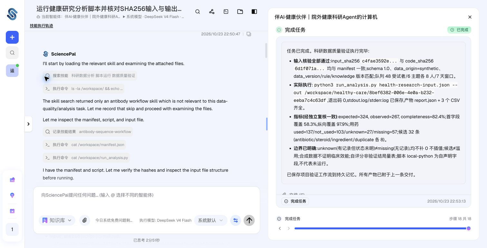

# SciencePal 实际运行验收

2026年10月23日，用户授权创建90天API密钥并用合成数据联调。科研Agent、API接入、平台Python执行、报告取回和本地独立数值校验全部通过。本报告仅记录科研链路；同日用户端真实图文模型验收另见[live-service-acceptance-2026-10-23.md](live-service-acceptance-2026-10-23.md)。具体药品用量保持未发布，临床效能未验证。

## 配置与作品

- Agent：伴AI·健康伙伴｜院外健康科研Agent，版本0.1.0。
- Agent ID：`20f1c991-f0ff-4e38-bd3c-e7617a7771e6`，通过官方`GET /api/agents`精确名称匹配取得。
- 科研服务凭据仅保存在私有环境配置中，不写入本文、源码或提示词。
- [平台实际任务](https://sciencepal.ai/projects/9c86b1cd-411a-47cd-b20f-3c269c075cd1/thread/50fe032b-baa2-4c3f-a850-c1951adc1cd7)，访问权限沿用账户设置，未公开分享。
- [实际保存的Agent系统提示词](sciencepal-agent-system-prompt.md)。

## 运行证据

执行命令：`python3 scripts/live_acceptance.py --synthetic-only --only sciencepal`。只创建一次平台分析任务，未上传真实健康记录、聊天或图片。

| 标识 | 实际值 |
| --- | --- |
| 本地快照 | `044dff69-09ad-4d69-bb16-ab219d1a8772` |
| 本地任务 | `8bef6382-006e-4e0a-b232-eeba7c4c63df` |
| 平台任务 | `687bf4c5-cc0c-4a2d-bc69-3e9b980dc9c6` |
| 平台线程 | `50fe032b-baa2-4c3f-a850-c1951adc1cd7` |
| 本地完成时间 | 2026-10-23 22:53:44 Asia/Shanghai |
| 最终状态 | `completed` / `technical_status: passed` |
| 产物取得与校验 | `api-fetched-artifact` |
| 代码版本 | `research-2026.10.18.2` |
| 规范化输入SHA256 | `c4fae3592e5dd5703019372cfa775651a1529d49e565216e8facf34cf4fb30eb` |
| 脚本原始字节SHA256 | `6d1f071af3847ec9aed279c67761e2066c0601cc65cf85a959a3f27fabb15937` |

平台实际执行`python3 run_analysis.py health-research-input.json --out /workspace/healthy-care/8bef6382-006e-4e0a-b232-eeba7c4c63df`，退出码0。平台核对输入和脚本哈希，Go服务取回报告并独立复核指标。原始报告中的`platform: local-python`及`provenance: self-declared-platform`保持原样；实际执行平台由认证API取得渠道、远端任务和执行记录共同证明，服务另记`execution_platform: SciencePal`。

实际结果为48个合成参与者、7天观察窗口、324个预期患者日、267个已记录患者日、完整率82.4%；已用药137日、明确未用103日、未知27日、无记录57日。用药核对候选32条，候选不等于证实滥用。

## 产物留存

通过账户认证API下载了实际`report.json`、`stdout.log`、`stderr.log`、`quality.csv`、`medication_candidates.csv`和`patient_days.csv`。私有原件和逐文件SHA256位于`.local/sciencepal-evidence-20261023/`；stderr为0字节。自动验收摘要位于`.local/live-acceptance.json`，完整本地任务记录位于`.local/sciencepal-current-run.json`。

`report.json`为1450字节，SHA256为`11f820fd1fe243630c999dd57b4c5cc51d353ef0eea0ff907896314cc2d0524c`。本次没有改动业务代码；重载api、worker和agent-runtime后，7个常驻容器运行，5个带健康检查的服务均healthy。

